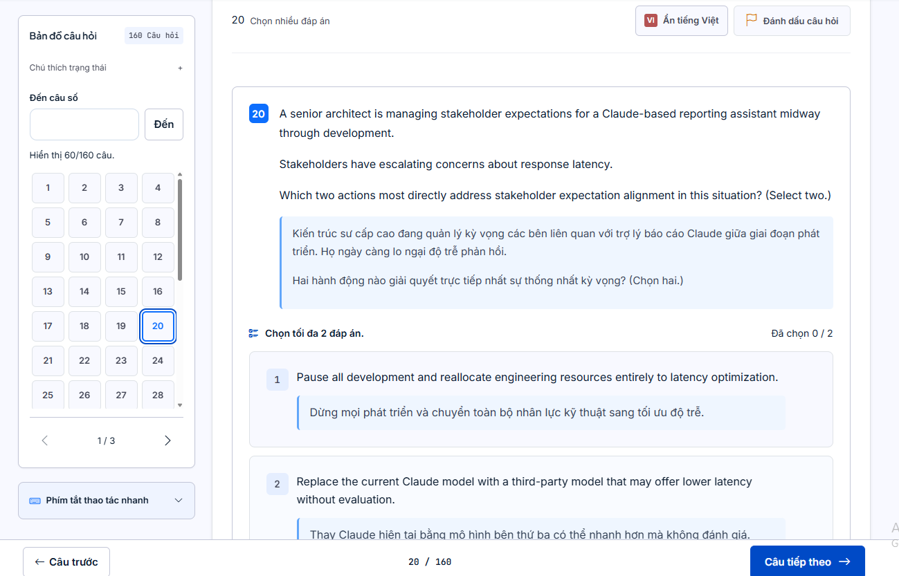

Bộ đề luyện chứng chỉ Claude, xem trực tiếp trên trình duyệt.

**Truy cập:** [https://cca.vnid.me/](https://cca.vnid.me/)

Nhập mật khẩu được cung cấp để mở bộ đề. Có thể chọn **Ghi nhớ mật khẩu trong 7 ngày** để chuyển giữa các bộ đề mà không phải nhập lại.

**Liên hệ nhận mật khẩu truy cập:** [trumxuquang@gmail.com](mailto:trumxuquang@gmail.com)



## Các bộ đề

```text
cca/
├── CCA-F-offline.html
├── CCAO-F-offline.html
├── CCAR-P-offline.html
└── CCD-F-offline.html
```

### Giới thiệu nội dung

- **CCA-F:** Kiến thức nền tảng về thiết kế ứng dụng Claude và hệ thống tác tử, gồm điều phối tác tử, sử dụng công cụ, quản lý ngữ cảnh và trích xuất dữ liệu có cấu trúc.
- **CCAO-F:** Củng cố kiến thức nền tảng về Claude qua các câu hỏi trắc nghiệm và tình huống ứng dụng.
- **CCAR-P:** Các tình huống kiến trúc nâng cao: lựa chọn giải pháp, bảo mật, phân quyền, đánh giá chất lượng, tối ưu chi phí và hiệu năng, triển khai và vận hành hệ thống Claude.
- **CCD-F:** Kiến thức nền tảng dành cho lập trình viên tích hợp Claude: API, Claude Code, Agent SDK, MCP, thiết kế công cụ, xử lý lỗi và tự động hóa quy trình phát triển.

### Cách sử dụng

- Dùng menu **CCA-F · CCAO-F · CCAR-P · CCD-F** để chuyển bộ đề.
- Nhấn **Hiện tiếng Việt / Ẩn tiếng Việt** để bật hoặc tắt bản dịch ở những bộ đề đã được bổ sung.
- Tiến độ làm bài được lưu riêng trên trình duyệt từng thiết bị, không đồng bộ giữa các máy.

---

## English version

Claude certification practice question sets, accessible directly in your browser.

**Access:** [https://cca.vnid.me/](https://cca.vnid.me/)

Enter the provided password to open the question sets. Select **Remember password for 7 days** to switch between sets without entering the password again.

**Contact to request the access password:** [trumxuquang@gmail.com](mailto:trumxuquang@gmail.com)

### Question sets

```text
cca/
├── CCA-F-offline.html
├── CCAO-F-offline.html
├── CCAR-P-offline.html
└── CCD-F-offline.html
```

### Content overview

- **CCA-F:** Foundations of Claude application and agent architecture, including agent orchestration, tool use, context management, and structured data extraction.
- **CCAO-F:** Reinforces core knowledge of Claude through multiple-choice questions and practical scenarios.
- **CCAR-P:** Advanced architecture scenarios covering solution selection, security, authorization, quality evaluation, cost and performance optimization, deployment, and operations.
- **CCD-F:** Developer foundations for integrating Claude, including APIs, Claude Code, the Agent SDK, MCP, tool design, error handling, and development workflow automation.

### How to use

- Use the **CCA-F · CCAO-F · CCAR-P · CCD-F** menu to switch between question sets.
- Click **Hiện tiếng Việt / Ẩn tiếng Việt** (Show Vietnamese / Hide Vietnamese) to toggle translations in sets where they are available.
- Your progress is saved locally in each device's browser and is not synchronized across devices.
